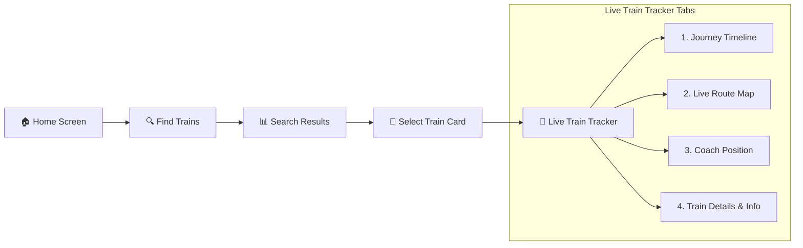

# 🚆 When is my train — Railway Live Status & Tracking App

A modern, fast, mobile-first **Indian Railways Information and Live GPS Tracking Application** built with **React Native**, **Expo**, and **TypeScript**. 

Designed specifically for seamless journey lookup and live status tracking without any booking, ticket fare, seat availability, or payment clutter.

---

## 🌟 Key Highlights & Philosophy

- **Zero Booking Clutter**: Focuses 100% on finding trains, live status tracking, station schedules, and coach positioning. No seats, fares, payments, or booking buttons.
- **Mobile-First High Density**: Search Results page fits **4–5 train cards** per screen view for quick scannability.
- **Where Is My Train Visual Identity**: Uses a clean, premium **Blue (`#0284C7`) + White + Green** theme with smooth micro-animations.
- **Live 4-Tab Train Tracker**: Deep train status view with 4 interactive sub-tabs (`Journey`, `Live Map`, `Coach Position`, `Info`).

---

## 📱 App Flow



---

## ✨ Features & Functionality

### 1. 🔍 Search Results Page
- **Smart Date Selector**: Horizontally scrollable date selector starting directly with **Today**, **Tomorrow**, day shortcuts, and a Calendar date picker modal.
- **Compact Filter Controls**: Instant sorting by *Fastest (short duration)*, *Earliest Departure*, *Latest Departure*, class filter chip (`SL`, `3A`, `2A`, `1A`, `CC`, `2S`), and Filter modal.
- **High-Density Cards**: Displays Train Badge, Dep ── Arr times, Total Duration, Number of Stops, Running Days (`S M T W T F S`), Train Name, and status notifications (*"Departed at..."* or *"Not running today"*).
- **Edge Case Handling**: Supports non-running days, past departed trains, same station search, empty results, and graceful text truncation.

### 2. 📍 Live Train Tracker Screen (4 Sub-Tabs)
- **Top Header & Action Bar**: Quick action pills for `Today` date filter, `Alarm`, `Coach`, and `Share`.
- **Route Summary Card**: Displays origin code/time, total duration, stop count, and destination code/time.
- **Tab 1 — Journey (Timeline View)**:
  - Complete vertical journey timeline from origin to destination.
  - **Passed Stations**: Green checkmarks (`✓`) with actual departure times and *"Departed"* tag.
  - **Current Station**: Blue animated train badge (`🚆`) with live pulse animation, station highlight, and delay status (e.g. *"Current Station · 2 min late"*).
  - **Upcoming Stations**: Grey node indicators with expected arrival times.
  - **Bottom Telemetry Bar**: Real-time display of Train Speed (`96 km/h`), Distance Left (`252 km`), and Expected Arrival (`10:20 AM`).
- **Tab 2 — Live Map View**:
  - Interactive route node diagram showing source, current GPS location, and destination.
  - Station delay card and one-tap shortcut back to the full journey timeline.
- **Tab 3 — Coach Position View**:
  - Visual horizontal train rake breakdown (`ENG` → `C1` → `C2` → `C3` ... `C8`).
  - Platform location guidance (e.g., *"Coach C3 will be near Platform 4 side"*).
  - Station platform tips and legend markers.
- **Tab 4 — Info (Train Details)**:
  - Technical information: Rake Zone, Average Speed, Running Days, Route Details, Total Distance, and Facility tags (`AC Chair Car`, `Wi-Fi`, `Catering`, `Charging Port`, `Bio Toilet`).

---

## 🛠️ Technology Stack

- **Framework**: React Native (v0.79.5) with Expo (v53.0.12)
- **Language**: TypeScript
- **Icons**: `@expo/vector-icons` (Ionicons, MaterialCommunityIcons)
- **State & Navigation**: React Custom Hooks, Stack/Tab Navigation without native overhead
- **Styling**: Native StyleSheet API with HSL & Hex design tokens

---

## 🚀 Getting Started

### Prerequisites

- [Node.js](https://nodejs.org/) (v18 or higher)
- [Expo Go](https://expo.dev/go) app installed on your Android/iOS mobile device.

### Installation & Running Locally

1. **Clone the repository**:
   ```bash
   git clone <your-repository-url>
   cd "When is my train"
   ```

2. **Install dependencies**:
   ```bash
   npm install --legacy-peer-deps
   ```

3. **Start the Expo development server**:
   ```bash
   npm start
   ```

4. **Run with Tunnel for Global Remote Access (Expo Go)**:
   ```bash
   npm run tunnel
   ```
   Scan the generated QR code using the **Expo Go** mobile app.

---

## 📁 Directory Structure

```text
├── App.tsx                     # Main navigation controller & back-handler logic
├── app.json                    # Expo project configuration
├── polyfill.js                 # Environment polyfills
└── src/
    ├── components/             # Reusable UI components (Header, TabBar, Cards)
    ├── data/                   # Train routes, station data, and schedules
    ├── screens/                # Main application screens
    │   ├── HomeScreen.tsx               # Origin/Dest station selection & search
    │   ├── SearchResultsScreen.tsx      # Compact 4-5 card search results
    │   ├── LiveTrainTrackerScreen.tsx   # 4-Tab Live status & timeline tracker
    │   ├── LiveStatusScreen.tsx         # Quick live lookup screen
    │   ├── PnrScreen.tsx                # PNR checker screen
    │   └── TimetableScreen.tsx          # Offline schedule viewer
    ├── theme/                  # Color tokens and design parameters
    └── utils/                  # Live status calculation engine & time parsers
```

---

## 📄 License

This project is licensed under the MIT License.
